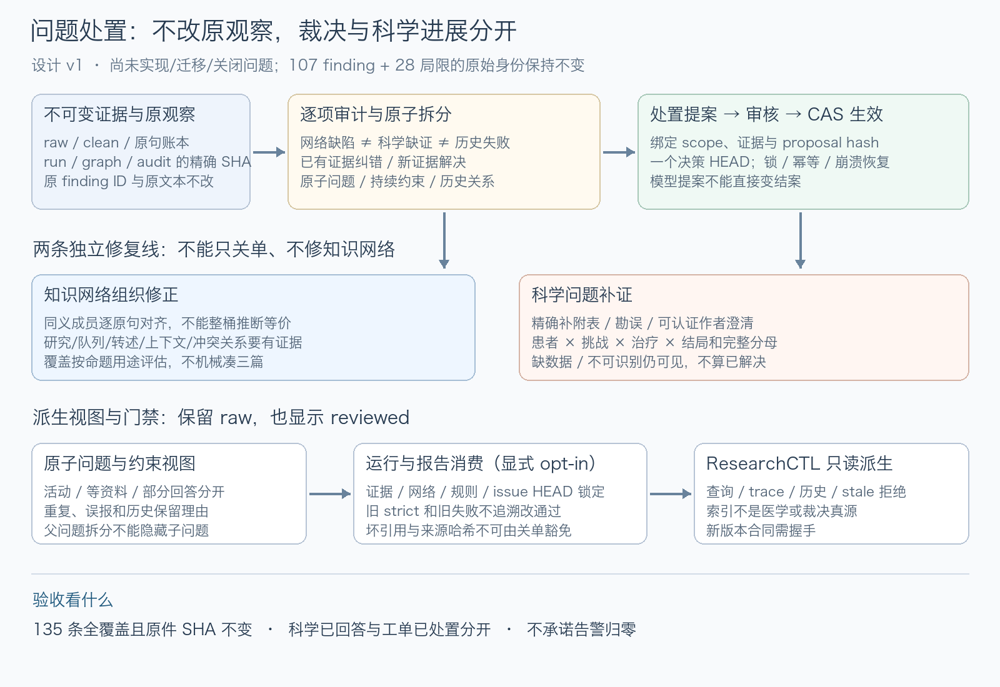

# 知识网络审计与问题处置机制设计

> 版本：设计v1，2026-10-23。**本轮只做设计和只读审计，未实现新状态机、图结构、规则或命令，未关闭任何原问题。**
> 当前代码基线：research-tool `acf6ff51d329b479a6f708ac995547b42517cd6d`；reader `4189ede89ace5828f11d6968153addf12b253a1c`。
> 本轮分支：`docs/finding-disposition-design-20261023`。前序[成文前证据方案](2026-10-23-researchctl-grounded-report-repair.md)及[当前状态](../../STATUS.md)。

## 1. 结论、目标与非目标

**用户质疑成立：当前知识网络确有组织、关系和覆盖度量的能力缺口。** 107项finding并不证明107处医学事实错误，但也不能简单解释成“告警多、系统没问题”。原文身份/跨度通过，与知识关系组织充分、独立证据充分、科学结论正确是不同的验收轴。

目标是同时做两件事：

1. 让每条告警/局限得到可复核的原子问题、约束或历史对象，而不是保留一串永远不会改变的文本。
2. 修正问题产生的网络表示和质量规则，防止用“人工关单”掩盖同义主题碎片、错标签、队列重复和缺关系。

非目标：本轮不实施生产代码，不改旧报告/图/audit/review，不重新联网检索或调用调研模型，不申请患者数据、不发送作者邮件，不安装issue平台或向量数据库，不建立临床预测器，也不把所有数字清零作为成功条件。

## 2. 设计依据：哪些问题已被证实

### 2.1 已锁定的实际证据

只读查询当前可采用报告、`reconcile`及原文件复核锁定：

- run：`d672f7fb457b4d4eaa00ba4f8c60847a`。
- report SHA：`1952b47401b0b7113aaddaed9dea83531844097dd7d4c722b0bfc950660ce585`。
- knowledge SHA：`8318740a68416fd8a58b128d03f3d9827b29cfbf08a491c51702149620cece4d`。
- evidence-audit SHA：`acb58de25c36b488358ae47d9101c57b96c7b081da1ab97cecf21fbc059bac75`。

完整135条医学审计只写授权医学工作区`/Users/xbpd/Projects/纤维蛋白预测/runs/finding-disposition-design-20261023/`：finding-review.json/CSV保留107个原finding，limitation-review.json/CSV保留28条原文本及原数组索引，README解释诊断，audit-manifest.json锁定输入哈希。`review_only=true`、`decision_applied=false`；没有运行状态写回。源run173个非派生文件前后哈希一致。

一次性生成/验证代码和日志放忽略目录`research-output/finding-disposition-design-20261023/`，不把医学原句和运行材料上传Git。归类是Agent设计审计，不是独立人类医学评审。

### 2.2 网络缺口，不是单纯缺文献

| 证据与源码 | 已证实的判断 | 不允许的夸大 |
|---|---|---|
| [`knowledge_min.build_evidence_graph`](../../research_tool/nine_loop/knowledge_min.py)按`fact.topic`原字符串分组；实际图键只有counts/facts/nodes/sources | 现产物是可追溯原文账本＋单层主题桶，没有显式临床范围/研究/队列/正反证边 | 不得称它已是能回答独立风险贡献的关系网；也不等于原文账本全错 |
| [`pipeline._extract_work/_knowledge`](../../research_tool/application/pipeline.py)只把facts和documents送入建图；relations.json有974条subject/predicate/object/source_file/confidence，无精确引文span | 语义关系没有接入正式核验链；不可直接把974条关系升级为正式证据边 | 模型关系confidence=1不证明其医学或因果关系成立 |
| 119节点，47个仅一条fact；每条fact只归一个topic，节点claim集合无重叠 | 主题碎片和单一归属限制跨主题定位；可能同时有颗粒度和成员失配 | 整桶同义合并不证明桶内所有临床论断等价 |
| 97coverage：83个一内容家族、14个两家族，全部统一目标三 | 衡量的是桶内来源多样性，不是逐命题的独立研究强度；101high也不等于101处高危医学错误 | 不得靠提高阈值、降优先级或补转载求绿 |
| 伦理、conclusion、strengths、研究设计也触发同样三源告警 | 质量规则没有区分研究自述/元数据和待复现临床效应 | 原研究伦理不需要另找三队列重复，取消此不适配规则不等于科学增益 |
| `出血风险`实际为出血病例中的亚型构成；`诊断准确性/性能`实际含定量缺陷严重度阈值表现 | 已有明确标签/命题范围失配，不只是“缺独立来源” | 不能将病例构成反转为亚型发生率，或将严重度分类当未来出血预测 |
| 512条全文补全集中`原文上下文与反证`大桶，原1558条fact中1517条被同源补全span包含 | 补全是必要取证依赖，不是新增独立研究；组织角色仍需显式表示 | 大桶10来源不代表内部每条结论有10项支持 |

### 2.3 对107＋28逐项审计后的设计输入

- 97coverage涉及238条原桶成员，均已读取。主审查路线：测量17、表型病史11、干预混杂11、研究元信息14、遗传机制20、挑战结局9、血栓5、明显成员/标签混杂10。路线不是互斥根因证明，更不是可关闭数量。
- 10模型finding建议拆22个原子子问题。已有原文能纠正“没有阴性挑战、没有调整项、流产都未分开”等过宽表述；未来挑战风险、治疗因果、纵向阈值、hypodys外验仍缺数据。
- 28文本局限混合历史复合问题、方法约束、原文冲突、材料任务、run范围和输入要求。L01–L28是本次锁定audit文件的索引标签，**不是跨run稳定ID**。
- `bleeding/出血/出血表现/clinical manifestations/临床表现`合计49facts、7来源；`outcome/outcomes/结局`389facts、10来源。它们是组织对齐候选，不是可整体等价的临床命题；流产、PPH、个案治疗成功必须保持不同范围。

## 3. 最小对象边界：原观察、原子问题、约束、历史分开



图中对象与写入流程是**待实施设计**。权威底座仍是原run及其证据，新增权威记录只证明“作出了什么裁决”，不能成为第二套医学事实。

| 对象 | 负责什么 | 身份与约束 |
|---|---|---|
| Observation（原观察） | 原finding、known limitation、失败诊断、审校拒绝 | `(root_id,run_id,artifact SHA,JSON pointer,原记录hash)`生成occurrence_id；原finding_id只是字段，绝不单独当跨run身份 |
| Issue（原子问题） | 单一可判定问题及验收要求 | 程序分配issue_id；明确人群/挑战/干预/结局/时间/单位、任务用途和所需证据；模型不能自选已有issue身份 |
| Constraint（持续约束） | 推断边界、不可外推、研究设计限制 | `constraint_id＋scope＋evidence`；适用即展示，不当普通未完成任务，也不能称已解决科学问题 |
| Decision（处置事件） | 分类、拆分、纠错、解决、重复、复开及其审查 | 版本化、前驱hash、证据及scope绑定；先proposal，再显式review，不让模型一次输出直接结案 |
| HistoryLink | 旧失败/被拒报告与修复版本/新run关系 | 表示`superseded_for_use`而非旧verdict变更；execution、report review和issue处置三轴不互相替代 |

本版不新增通用工单功能：不做人员通知、排班、跨组织权限体系、WebUI和外部平台同步。owner仅可为现有执行者标识；未有认证身份时，`actor_label`是自述标签，不对外宣称身份认证或独立人审。

## 4. 状态与裁决：处理完成不等于科学问题解决

### 4.1 两轴状态，避免把等待数据伪装为结案

- `lifecycle = open | working | pending_review | closed`。
- `assessment = unassessed | partially_answered | awaiting_material | awaiting_data | not_identifiable_under_scope`。
- `resolution = null | resolved | corrected | duplicate | decomposed | out_of_scope | superseded | reclassified_constraint`，仅closed可非null。
- `scientific_answered`、`new_scientific_evidence_added`是独立审查字段，不能由closed或新fact数量自动推导；软件/报告纠错可能closed但二者均false。

基本流：open→working→pending_review→closed；pending_review拒绝回working。awaiting_data/not_identifiable仍open或working，不计resolved。处置只能由合法reviewed event生效；闭合后的新证据/规则漂移触发`reopen`或`needs_revalidation`事件，旧关闭理由留历史。

Constraint使用`applicability=active|superseded`，不混入issue关闭数。原子问题转为约束必须有reclassified_constraint裁决，前后计数/科学仍未知分别显示，禁止用换类别隐藏未满足的报告要求。

### 4.2 各裁决必须提交什么

| resolution | 必需依据 | 不能发生什么 |
|---|---|---|
| resolved | 原子问题验收全部满足；固定证据/计算/方法/范围与review | `needs_data`、非显著、空搜索或免责声明不能当解决 |
| corrected | 原告警确有误报/过宽表述，或报告问题已有原文回答；可用同一snapshot已有claim | 不要求伪造新增claim；更正告警不计新增研究或因果证据 |
| duplicate | 目标issue存在，原子问题、范围、验收条件一致；显式关系和原观察全保留 | 同义标签/语义相似/同论文不足证明重复；禁止循环引用和互相duplicate |
| decomposed | 原复合观察到全部parts的无遗漏映射；每part独立状态 | 父项不再活动不意味着所有parts已解决；未回答子项必须继续可见并计数 |
| out_of_scope | 版本化任务契约明确不要求该问题；修改范围需用户授权 | 不得在不改任务合同情况下把核心临床目标移出范围，旧报告不追溯变通过 |
| superseded | 精确新对象/版本和适用用途；旧对象保留 | 新run通过不改变旧失败/旧review rejected |
| reclassified_constraint | 证明是持续方法/研究范围约束，附scope和后续推断限制 | 不把可补的附件/事件数据任务改为永久约束后消失 |

关闭模型finding时分两条路径：**已有证据纠错**和**新增证据解决**。现有[`_retain_unresolved()`](../../research_tool/nine_loop/research.py)只接受与新增claim相交的resolution，新设计不能直接删除该防线；应保留旧路径，为reviewed纠错引入独立版本合同与更严格裁决记录。

科学复合问题例如“未挑战vs已挑战”：拆为“存在阴性挑战？”（已有原文支持）与“下一次同类挑战风险？”（仍awaiting_data）。不能以第一项关闭原问题全部含义。

拆分/合并关系自身必须无循环：duplicate/decomposed/superseded的目标均已存在，且不能同时将所有成员互相移出活动集合。若没有剩余canonical issue承接未满足要求，则提交失败，而不是按数量减少宣布完成。

### 4.3 因什么复开

证据变更/缺失、source身份/研究队列改判、任务定义/结局/单位变化、覆盖规则/词汇映射改版、裁决依据的新反证都使原裁决当前适用性变stale。不能以“文件时间更新”重绑证据，也不能自动将新snapshot当旧结论复核通过。换成全新问题只记关系，不无理由复开无关问题。

## 5. 必需数据合同（设计草案，尚非生产schema）

每个事件最少包含：`schema_version, registry_id, event_id, idempotency_key, prev_head_sha256, target_issue_id, event_type, expected_issue_revision, scope, origin_refs, evidence_refs, rationale, actor_label, actor_authority, reviewed_proposal_sha256, timestamp_utc, payload`。创建/导入事件的前驱revision可空，但必须说明类型；后续必须精确匹配，不能以同名issue覆盖新版本。

`registry_id`及允许的`root_id`由显式项目配置固定，位置迁移只更新经授权的root映射，不靠目录名或绝对路径猜新身份；同一语料不能隐式建两个registry。`origin_ref`与`evidence_ref`只指向授权的root_id＋相对路径＋artifact SHA；原run_id、graph/snapshot SHA固定；再用JSON pointer/claim_id或精确span指到内部证据。JSON pointer和原记录hash必须同时相符，不能仅用topic文字或模型ID猜归属。任何新材料先走正常摄入/身份/hash/span/已提交stage链，再作为证据被引用，不允许在issue文本中粘贴一段无来源结论充当原始证据。

`scope`按问题类型取最小必要字段：`purpose, population/subtype, challenge/index_event, intervention_condition, outcome, time_window, denominator_unit, target_requirement`；unknown允许但不得在结案后假装已知。本文不预置完整临床本体；不能用一组字段代表已经取得患者级数据库。

`review`引用精确proposal hash与evidence set hash，说明检查结果及`agent_source_review`或明确人类授权级别。复核还必须锁定本次适用的任务scope、network map和assessment policy hash；任何一项变动都不能复用旧approve。单Agent可做本机原文裁决，但如实标self/agent，不宣称独立人类签名。不能借review_id把human_clinical标记填出来；身份、批准级别与有效证据需可执行验证。

一次处置示例（字段节选，不是实际结案）：

```json
{
  "event_type": "review_disposition",
  "expected_issue_revision": 2,
  "resolution": "corrected",
  "scope": {"purpose": "report_adjustment_disclosure", "outcome": "PPH"},
  "evidence_refs": [{"run_id": "<exact-run>", "artifact_sha256": "<pinned>", "claim_id": "<existing>"}],
  "scientific_answered": false,
  "new_scientific_evidence_added": false,
  "rationale": "原文已有调整变量，关闭错误缺失表述，不据此确定因果贡献",
  "reviewed_proposal_sha256": "<exact-proposal>"
}
```

## 6. 新增记录的权威位置、事务与读写边界

### 6.1 一个决策账本，不在两仓各造当前真值

未来每个明确research corpus/work_dir配置**一个**`issue_registry_root`，建议复用授权运行输出边界下`issue-dispositions/`职责目录。生产者负责原run/graph/audit，处置账本只负责裁决事件；ResearchCTL和任何界面只读派生投影。两仓绝不各维护一份可编辑当前问题表。

最小持久结构：不可变`revisions/<content-hash>.json`与唯一`HEAD.json`；每revision锁定prev hash及事件，HEAD由现有原子写/POSIX flock/CAS模式发布。`current-issues.json`/SQLite/CSV/INDEX如需生成均标派生，可删重建；本设计不引入数据库依赖、分布式事务或第二运行调度器。

该目录是**拟议新增责任单元**，本轮不创建。原医学run的final/review、工具repo的代码事实仍各在原权威位置，不能搬入issue目录后复制两套证据。

### 6.2 事务要求

1. 取得稳定writer lock（不unlink锁文件），检查expected HEAD与issue revision，再回读proposal和证据hash/路径/scope。
2. 在临时同目录文件写完整revision并fsync，独占安装内容寻址revision、fsync目录，再原子替换HEAD并fsync父目录。
3. HEAD发布前崩溃的孤立revision不是当前裁决；resume只能验证后重试同idempotency key，不凭mtime选最近。发布后重复事件返回同一回执，不能重复计数。
4. reader锁定HEAD和完整可验证前驱链，读取前后回验；HEAD/CAS冲突、缺event、未知schema或文件hash漂移fail-closed，不读旧SQLite混为当前。
5. evidence root白名单、相对路径、no-symlink containment沿用现有reader规则。未授权root、特殊文件、跨目录逃逸、凭据/未公开患者文件均不可因issue导入自动读取。

这是设计要求，实际进程崩溃/并发验证尚未运行；不能用文档承诺替代后续可执行测试。已有`RuntimeState`锁/原子提交模式可复用，不能拿某run的lock替代跨run处置账本的实际单写锁。

## 7. 知识网络必须同步补什么（不直接导入974条无span关系）

### 7.1 最小可核验语义映射

保留旧raw/clean/claim不可变身份；新合同可用`network-evidence-map/v1`表示原graph snapshot之上的**经审核语义映射**，而不是把旧graph悄悄改写。先只支持：

- 主题成员映射：原claim→候选规范概念，保留原topic、alias来源、scope、review与规则版本。一个claim可在导航上多归属；不据此算多份证据。
- 研究/队列身份：article/study与cohort分开；明确`reports_on`、`secondary_citation_of`及`possible_overlap_with`。同注册库不等于确定全员重复，不明重叠标unknown，不宣称独立。
- 可审查论断及依赖：`quote_supports(scoped_assertion)`、`requires_context`、`conflict_candidate`。临床scope至少能区分人/操作/妊娠/分娩、治疗/抢救时点、PPH/流产和定性/定量亚型。
- 每一条正式边都有固定原claim/span与review；不能从confidence、同topic或语义相似直接生成因果边。抽取出的974条无span关系只当候选线索，先按真实原文支持重新绑定，失败即拒绝。

同源包含关系/句子和整段重复要显式标`context_of`，不删除分母/表头来求去重，也不计新增独立研究。方法/人口学/伦理/讨论转述要标证据角色，防止source bucket多就升级论断。

### 7.2 覆盖度量的修正边界

原始`content_family_count/minimum_sources=3`计数继续保留为legacy metric；新规则必须锁定`assessment_policy_id/version/hash`和用途：

- 研究自述/元数据：以单一原研究身份和精确支持为核验要求，不机械要求三独立研究重复同一伦理或入组日期。
- 描述性原研究率：要求正确人群/单位/n/N/治疗/时间/缺失/重复事件，不用“来源≥3”代替分母。
- 跨研究或可推广临床结论：审查独立cohort、终点与策略可比性、效应/精度/偏倚；有三篇也不自动充分，有一篇也不自动错误。
- 机制/病例/专家建议/预测/因果分别声明证据要求；缺独立数据的核心结论保持缺口，不能因换指标或主题合并而关闭。

新旧评估并列：`raw_legacy_findings`、`representation_defects`、`proposition_evidence_gaps`、`source_conflicts`各自计数。只有纠正了可核验结构，才叫网络修复；只有支持研究问题的新证据成立，才叫科学进展。**本轮不估算归并后会剩多少项，也不承诺归零。**

活动计数以原子issue_id去重，但报告必须同时展示原观察数、原子问题数、已处置原因、持续约束数及尚未评估项。`pending_review`不计已关闭；`decomposed`父项仅计结构处置，其所有open子项仍进入required unresolved；awaiting_data/not_identifiable继续计未回答。报告应保留`administratively_disposed`和`scientifically_answered`两个不同数字，二者不能互相替代，也不能把网络分组后的告警下降报成科学证据增加。

## 8. 接入九阶段与原合同的方式

1. 保持原九阶段、canonical run-record字段、旧qgate行为及旧图读取不变。
2. 先在新处置审查任务中生成proposal，不让inspect模型直接写决策HEAD。proposal和review生效必须绑定同一evidence/network/policy snapshot。
3. 第一实施批仅产只读问题视图和差异，不影响qgate或报告采用。后续用户批准新合同后，显式配置`issue_policy=raw|reviewed`（拟议）并纳入runtime指纹；默认raw不获得新保证。
4. reviewed评估必须并列raw verdict与reviewed verdict，不能追溯改旧STOP_BUDGET/STOP_ERROR。已纠正误报可不再作为活动问题阻塞，但open/awaiting_data/not_identifiable的强制科学问题仍不视为解决。
5. strict的真实缺证不得因reclassified_constraint/out_of_scope/decomposed消失：各child及新scope要求都必须计入。layered仍可披露不足，不等于strict完整。
6. 来源hash、账本ID、执行错误、过滤、坏引文等**硬检查不进入可豁免issue裁决**；任何人/Agent关单都不能覆盖它们。
7. 新报告将使用的issue HEAD/network map/policy digest进入自己的sidecar/summary及report审校绑定；ResearchCTL只读取明确版本契约。旧reader拒绝未知required contract，不能忽略裁决版本后仍称当前reviewed结果。
8. 旧报告的审校结果仍只对当时报告/证据/范围有效；若新增反证影响当前采用，追加拒绝/复核记录，不删除旧passed。无关issue变化不自动撤销不受影响报告。

## 9. 135条的迁移与对账

- 现107finding按原audit指针/hash各导入一个Observation；28局限按原索引/hash导入。原始总量始终107＋28，不因任何分类更改。
- 对历史L01–L08和现model gap建立`related_to`，先审查再决定duplicate或split；不靠文字相似自动认同。10个模型问题的22parts只是本轮提议，全部not_applied。
- 元数据/报告纠错/不可识别/材料/约束/历史分别形成对象。一个复合Observation可关联多个Issue/Constraint；必须覆盖全部有实质意义的子句。
- 源文冲突拆到具体原句，如Shapiro图/正文/摘要与Miesbach人数/血栓算术两类，认证勘误/说明到达前不得resolved。撤回Agent旧子组误解可以corrected，但不能顺带关闭原作者冲突。
- 迁移预演显示`135原观察→原子问题/约束/历史映射＋无法判定列表`，只能由后续显式迁移提交生效；无决定不丢弃。迁移前后原run/report/audit SHA必须一致。
- 不迁移原医学源库或把动态补搜失败变“无科学证据”；动态检索恢复、新全文身份、抽取和新报告审校是独立新run任务。

## 10. 反例验收（实现前必须先红后绿）

| ID | 反例/输入 | 必须观察到的结果 |
|---|---|---|
| A01 | finding_id相同但run/audit不同；局限索引相同但内容变 | occurrence不同或拒绝歧义，不能串案/继承关闭 |
| A02 | 135原观察导入和复合拆分 | 原内容/hash全保留、映射完整；父disposed不能隐藏open child |
| A03 | 同snapshot已有Methods/分母纠正“原文没有” | corrected允许已有claim＋范围review；新科学证据数仍零 |
| A04 | 新论文/作者说明未摄入或仅无hash文字 | 不得作为关闭证据；经正常链后再提案 |
| A05 | 血栓/PPH/流产、患者/妊娠/分娩或替代/所有预防范围换了 | 不能继承旧问题解决状态；scope冲突拒绝/复开 |
| A06 | 同义topic归并使family数达到三，或PRO同库两论文 | 只显示组织变化；不自动宣称独立队列/临床充分，不自动resolved |
| A07 | 无span的高confidence关系直接升级正式因果边 | 拒绝；必须原文/范围/review可回验 |
| A08 | negative/empty search/有限随访无事件作为终身安全或全文不存在 | 不得resolved；unknown/data requirement/约束继续可见 |
| A09 | duplicate循环、互关、只靠相似词判重复 | 拒绝；必须存在目标和相同原子scope/验收 |
| A10 | 把未满核心要求改out_of_scope/constraint/awaiting_data | 不算scientific_answered，不使strict自动成功，需新授权scope或继续缺口 |
| A11 | evidence/network/policy改版或review proposal哈希变化 | 原裁决当前适用性stale，采用明确失败/复审，不读旧派生库 |
| A12 | 双写同expected_HEAD、写后崩溃、HEAD前后重试 | 单写CAS拒冲突、孤立revision不生效、幂等与恢复有真实证据 |
| A13 | 篡改原文件、symlink逃逸、schema未知、伪造human级别 | fail-closed，不由关单覆盖硬检查/权限 |
| A14 | 新版本修复原失败/新报告通过 | 旧verdict/review/hash不变，只有supersedes-for-use关系与新有效状态 |
| A15 | strict/layered完整九段、issue_policy默认和显式reviewed、resume | 默认旧合同兼容；变化进指纹；报告与issue/network/证据版本一致，零模型恢复可复核 |

文档存在和模型自述不算这些测试通过。本轮只检查设计完整性、135映射与原件哈希；后续采用现有pytest/E2E，不建设第二测试框架。

## 11. 最小实施批次、版本与当前交付

| 批次 | 范围 | 完成判据 |
|---|---|---|
| D0（本轮） | 135条只读设计审计、本方案与PNG、状态导航 | 全覆盖/原件不变/审查/提交推送；**不应用裁决、不改生产** |
| I1 | Observation导入、Issue/Constraint原子提案、只读派生视图 | A01/A02/A03/A05/A09；135对账、已有证据纠错不要求假新增claim |
| I2 | 最小revision HEAD/CAS/review与证据生效规则 | A04/A10–A14；实际并发/崩溃/权限与幂等，不提前接qgate |
| I3 | 已审核topic成员/研究队列/上下文边、用途特定coverage策略 | A06/A07/A08；旧图不改、新图/规则版本和真实误报对照，无科学增益伪装 |
| I4 | 显式reviewed消费、九段/报告/ResearchCTL与迁移 | A15及全部反例；原strict/layered兼容、新run范围验收，不能用旧报告冒充 |

实现位置优先复用现有`domain/models.py`、`nine_loop/research.py`、`infrastructure/retrieval/`与RuntimeState事务约定；只在出现独立职责时新增最小disposition模块。上游reader只加合同消费，不在其dirty主树重复建问题事实。具体生产文件拆分在实施前按实际调用链确定，本轮不创建空目录或空API。

所有实施用独立feature分支、小提交与双仓契约互锁；受影响回归、真实内部E2E、安全/文档/审查后及时commit/push，main只经PR。回滚用新合同禁用/旧raw读取及必要`git revert`，保留决策事件和证据；不得reset/clean/强推或改旧run求兼容。

**当前交付：设计v1＋135条审计建议；下一步是I1先写反例并实现只读处置视图。** 本轮没有运行新模型/补搜，没有改变已验收报告的采用状态，更没有将107finding或28局限人为清零。
