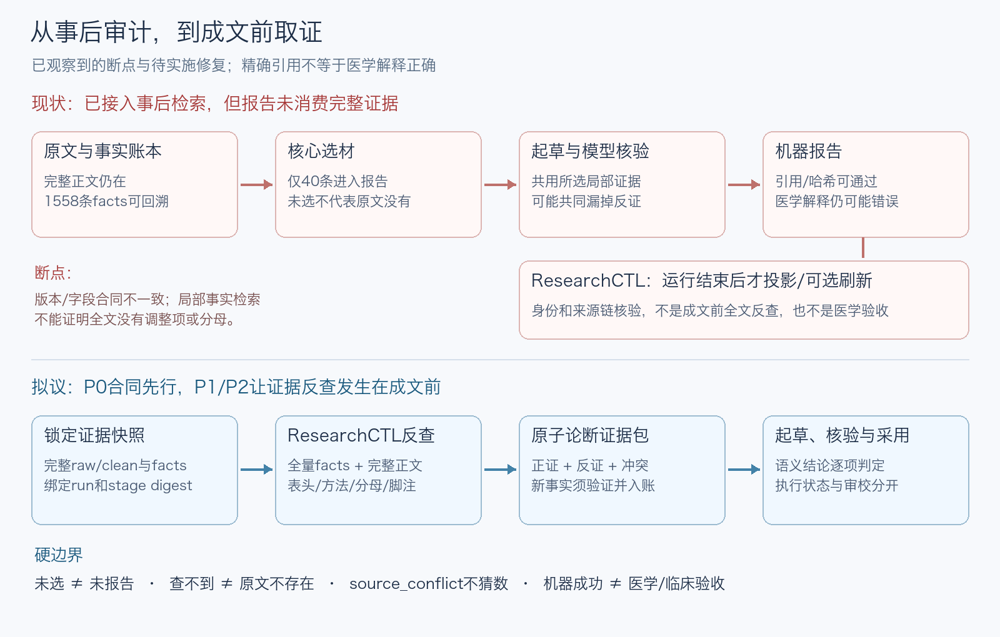

# 自动报告医学语义失真：根因与ResearchCTL修复方案

> 日期：2026-10-23。当前状态：**P0–P2实现与回归通过；P3在冻结10篇公开全文自动综合＋Agent原文审校范围通过。** 新检索覆盖、人类临床专家验收和临床预测有效性不在本次通过范围。下文根因与P0–P3设计保留为实施前规范，实际实现/验收见本节及STATUS。
> 范围：research-tool报告证据消费、ResearchCTL接口与验收合同。不新增搜索引擎、不重建向量RAG、不改历史自动成果。
> 开发入口：[Agent.md](../../Agent.md)；前序[接入方案](2026-10-18-researchctl-integration-plan.md)及[路线图](2026-10-18-researchctl-integration-roadmap.md)。

## 后续问题处置设计（未实施）

本轮通过范围不意味着现有knowledge已经是完整临床关系网络，或107finding/28局限可忽略。后续[知识网络审计与问题处置机制设计](2026-10-23-finding-disposition-design.md)保留135个原观察，区分网络结构/覆盖指标、报告纠错、真科学缺证、持续约束与历史；本轮不改原报告、问题状态或生产行为。

## 0. 实施与验收结果

- reader `341d044`：真实producer/consumer文件集合和title合同、报告采用review及成文前evidence-snapshot/v1；独立feature分支已推送，未改主文字系统dirty工作。
- tool首批`054768d`后由真实失败逐项修复：最终runtime19/`6dcbd99`，恢复投影`eb9f232`；writer不自由生成医学结论，只选程序验证的类型/原句闭集choice IDs，verifier用源内短ID后映回不可变账本。
- 必需原文由required_source_evidence显式绑定locator/唯一quote/fact，缺失/重复/歧义拒绝；27句17组在最终正文直接展示。模型修复不能删除或换掉所选证据，数值由程序逐字原文展示；补上下文走精确入账/CAS及同源确定性重检，科学缺口不因此关闭。
- 最终独立run`d672f7fb457b4d4eaa00ba4f8c60847a`：STOP_SUCCESS，10源/2070facts/119nodes、60项中文观察+27必需句、147报告claim、125final哈希，报告SHA`1952b47401b0b7113aaddaed9dea83531844097dd7d4c722b0bfc950660ce585`。Agent逐原文60项审校通过并绑定review，采用查询成功；human_clinical拒绝。107finding/28局限保持。
- 零模型真实resume后report哈希未变，ResearchCTL index/trace/sources/reconcile/采用门禁通过。全量1310 passed/3 skipped；上游11layout/body、443legacy checks通过，159bench/其他通过及3基线失败分别记录；不修改旧benchmark证据让其变绿。
- P3明确冻结10篇全文、max_rounds0。动态新PubMed正文empty_extraction失败保留，不声称新检索覆盖或最新系统综述。旧STOP_ERROR/STOP_BUDGET、两份机器成功但医学rejected均不追溯改通过。
- 成果与逐项回读在医学工作区`runs/grounded-report-20261023-final-v3/`；红绿/运行/审查证据`research-output/grounded-report-implementation-20261023/`，仅本机ignored保存，不提交论文或模型凭据。

## 1. 原始根因结论与目标（实施前快照）

**根本原因不是缺少本地论文，也不是引文哈希错误，而是把“当前选材中没有”误当成“原论文没有”，再用相同的局部证据集自证支持。ResearchCTL已接入事后运行审计，却未接入成文前取证；其当前部署、输入合同和查询范围也不足以承担完整原文反查。**

引入本地文字Agent检索系统的方向正确，但它只能保证“定位、版本和来源链可核验”，不能自动判断医学解释正确。需要让生成与核验真正消费它的完整证据回查，并把“机器完成、语义核验、专家验收”分开记录。

本轮已将前期修补保存为提交`fe7677960cdb0efac360dc93d9a8ffd0a9c6321d`，OCR测试同步修复为`5917608`，均推送到`fix/structured-extraction-diagnostics-20261020`。这些提交不是本方案P0–P3已完成的证明。此前自动医学终验失败保持不变。

### 本次方案要回答什么

1. 为什么精确引文/跨度/哈希都通过，报告仍说错？
2. 为什么现有ResearchCTL接线没有阻止它？
3. 怎样最小接入完整原文、反证与显式审校状态，而不建立第二真源？
4. 用哪些反例验证修复，而非仅重复一轮模型自评？

## 2. 已证实的错误链

研究工作区：`/Users/xbpd/Projects/纤维蛋白预测/runs/layered-report-20261021/`。下表均指机器成功但医学回读失败的run `53a9c17d04834a2696ac0819f9e36348`。

| 案例 | 自动报告的错误/不足 | 完整证据实际在哪里 | 丢失位置 |
|---|---|---|---|
| Casini2015，report.md第39行 | OR5.8后称模型协变量在来源中未详述 | 方法明确年龄/产次调整，结果另写parity- and age-adjusted；这两句已在全量facts | 两条均未选入40条报告核心证据；方法距该段所引span约12327字符，另一结果句约259字符 |
| PRO-RBDD2025，第45/53行 | 无症状者50%流产，但称原文未给分母细节 | 原文明示5名女性10次妊娠；已在全量facts | 分母fact未选，距所引讨论span约7262字符 |
| Sun2026，第61/63行 | 称缺效应值/CI、上述均未调整 | 清洗正文Table4有0.99、0.96、5.43、2.13及各CI；0.96/5.43/2.13所在位置没有覆盖它们的fact | 部分表格证据未抽取，不能只在selected facts或全量facts里搜索 |
| Shapiro2013 | 图10/35、正文15/35、摘要20/35并列，未适当解释冲突；本会话又错误猜成子组 | 原PDF印刷p222图注是全部35人，不支持子组解释 | 源文冲突没有成为每条结论的强制限制；Agent解释也未先完成原PDF核对 |

报告SHA-256为`8331c736fa755049ed1c885bc5eeefb374c284327d95e99343a5c4e16241d0ce`。1558条facts只选40条，1518条未选；全量账本仍在，并非原件丢失。单独审校版已撤回子组解释、补回调整项/分母并保留冲突，不能据此改写自动run已通过。

本地诊断证据位于`research-output/report-grounding-20261022/`（忽略，不上传论文/运行原件）：

- `omission-trace.json`：错误段落、原claim IDs、反证全文位置及是否被选用。
- `shared-support-counterexample.json`及`probe_shared_support.py`：合成原文含调整项，但选材遗漏；故意错误放行的mock verifier仍让报告通过。它证明当前门控没有独立硬约束，**不代表真实模型错误率测量**。
- `adapter-probes.json`、`read-only-contract-check.json`、`second-contract-mismatch.json`：版本/合同失败证据。只读scan前后170个原运行文件SHA相同。

## 3. 根因定位：生产、消费、验收三层

### R1：证据被裁剪后，开放世界被当成封闭世界

[`assemble_report()`](../../research_tool/nine_loop/research.py)先选择核心facts，再仅向本节draft和verify传`section_facts`。选择上限是综述长度控制，不是“已覆盖论文全部方法/分母/反证”的证明。

当前邻近上下文`_report_source_context()`只加前后700字符，能改善近邻表头，却无法找回距引用7262或12327字符的方法/结果；最新增强提示也尚无通过医学审核的真实自动运行。固定扩窗不能替代按问题回到完整来源。

[`Extractor._evidence_units()`](../../research_tool/infrastructure/stages/extractor.py)按块和行划原句，精确性成立但不保证抽取召回完整，更不保证表格的表头/行列/脚注/人群一同入账。Sun案例证明只检索facts还不够。

### R2：支持检查与起草共用同一证据盲点

[`verify_section()`](../../research_tool/nine_loop/research.py)另发一次模型请求，但依然使用同一LLM客户端、同一selected section_facts。提示写“独立”并不等于证据独立，也没有让校验者回完整来源检索。

[`verify_span()`](../../research_tool/nine_loop/evidence.py)证明的是`source[start:end] == quote`及正文hash相同，不证明“论文未报告”、表格归属、治疗条件、OR与RR等推导正确。当前`SupportCheck`只给段落布尔值/理由；逐次checks和反证搜索没有作为结果字段持久化。`citation_coverage=1.0`只能表示段落绑定引文，不是语义正确率。

### R3：ResearchCTL只接在运行末尾，且部署版本并未真正用于本次报告

[`pipeline._summary()`](../../research_tool/application/pipeline.py)结束时才写retrieval manifest，再可选refresh；[`_report()`](../../research_tool/application/pipeline.py)没有调用[`ResearchCtlClient`](../../research_tool/infrastructure/retrieval/client.py)。本次两份真实配置均未配置retrieval，默认`refresh_on_run=false`，运行输出没有派生索引。即使只把refresh打开，也是在生成错误报告以后。

本机只读核验的版本：

| 位置 | 实际身份/能力 | 本轮观察 |
|---|---|---|
| `/Users/xbpd/Projects/文字Agent检索系统` | HEAD`bbbe00bf5122481b537090a5c906d97510f2a08f`，另有并行未提交工作 | 主CLI无`--layout`；以research-tool布局调用exit2。不是可直接替换的部署版本 |
| `/Users/xbpd/Projects/researchctl-layout` | 干净工作树HEAD`553b3abde4d828358f414e414cb857857b13c787` | 有layout adapter；真实生产输出仍触发严格合同拒绝 |
| research-tool Python环境 | 未安装researchctl模块 | 需要明确module_root或安装已验收版本，不能只记录一个源码路径就声称接入成功 |

前序路线图M1–M5勾选表示当时限定fixture/接口实现，不是本轮真实医学输出互操作已验收。

### R4：生产者/消费者合同漂移，现有测试没跨过真实边界

生产者[`manifest._citation_sources()`](../../research_tool/infrastructure/retrieval/manifest.py)不输出`title`；adapter `researchctl/layouts/research_tool.py:_evidence()`要求该字段。真实只读scan首先报`PROVENANCE_BROKEN: citation_source 缺少规范字段`。

另一个不一致：生产者summary列全部123个final文件，canonical run-record只列约定的4个主文件；adapter `scan()`却要求`summary.files == record.files`。仅在诊断内存视图从同snapshot补title后，下一错误确定为`current summary.files 与 record 不符`。**没有修改原manifest、绕过hash或据此声称兼容通过。**

adapter的`test_research_tool_layout.py`明确自造fixture、不消费producer产物；双方各自测试绿，仍可对同名v1合同理解不同。

### R5：现有检索查询仍以报告已用事实为中心，且把执行fresh与医学可采用混在一起

对adapter `research_tool_query.py`/`research_tool.py`的源码核对：

- `_claim_items()`和projection只投影报告已用claim；1518条未选fact不会以claim候选返回。
- `query --text`在候选item序列化字段中匹配，不是完整clean正文搜索；raw路径/元数据查询也不等于搜过正文。
- 非成功run不暴露完整知识图供报告证据消费；只有成功final才有现有报告trace。成文前不能依赖“成文后才存在”的成功manifest。
- `status.research=fresh`由执行success推导；没有独立医学审校结果。当前源文审校失败不会自动改变旧机器成功身份。

所以即便修好title和files后直接`query --text`，也不能保证找回未选方法或未抽出的原表。ResearchCTL应扩展证据消费范围，而不是让模型把“空查询”说成“原论文未报告”。

### 不是上述根因的事项

- 论文自身的Shapiro人数和Miesbach9/37与19%、全体9/子组12无症状冲突，不能用程序生成正确答案。应标记source_conflict并列两处，禁止猜测调和。
- 后续run `58cc82a47cfc4bbe80f506842e67e92e`的`content_filter`是已观察到的服务终止，不是已证实的医学错误根因；无法从118037个prompt token推断过滤原因。明确过滤即停，不换词/拆请求/换后端绕过。
- 增加论文数、改用更强模型、扩大max_tokens、提高finding阈值或换向量库，都不能替代上述合同与证据闭环。

## 4. 目标机制：让反查发生在成文前

图中“拟议”表示实施前目标架构；当前实现/验收见§0。只保留原九阶段：证据准备属于inspect/targeted/merge和report内部，不另建第十个正式阶段或第二调度器。

### P0：先修互操作与“采用状态”，不动医学结论

1. 固定双方提交与能力标识：module_root不默认猜目录；启动握手确认layout/contract版本，缺能力给明确失败，不默默落到legacy。另一仓库升级须在其独立授权分支完成，保留主树并行工作，当前任务只提供方案。
2. 选定title单一规则：从同snapshot的final.sources派生并核对，或生产者显式输出；不能随手删除消费者验证以求绿。
3. 保留canonical run-record字段和4文件集合；consumer检查它们是summary的同hash子集，额外summary文件必须严格等于report/runtime envelope已提交的final集合（含audit/树），逐字节校验，不能接受任意额外文件。
4. 增加真实producer→consumer离线契约验收：用现有MockLLM外部边界真实跑strict/layered九段，再交ResearchCTL index/query/trace/reconcile；不得仅各造一份JSONfixture。
5. 为源文审校另设版本化review sidecar/登记，不改旧run verdict；按run_id、report SHA、证据snapshot SHA绑定`not_reviewed / passed / rejected`及依据。对旧无审校记录只能说execution_success，不能宣称medical_accepted。
6. 普通历史查询仍可见机器成功报告，采用报告必须显式要求所需review级别；rejected/未审不得回退为“可采用的latest_success”。Agent审校、人类临床专家验收是不同review级别。

P0完成判据：本轮真实输出能被完整性层读取，同时仍明确医学审校rejected；producer真实输出端到端契约测试通过。不能把成功索引计为医学通过。

### P1：成文前固定证据快照，复用ResearchCTL检索内核

- 在已提交knowledge/merge阶段后冻结一个只读`evidence-snapshot/v1`：run_id、输入指纹、上游stage key/digest、graph SHA、全量fact IDs、每源raw/clean路径与artifact/body SHA。
- 它不是final报告，不伪造STOP_SUCCESS或completed report。由ResearchCTL增加显式evidence-snapshot读取视图，允许完整性通过但尚未成文的证据被查询；失败run也只能作为标明状态的证据，不能自动成为当前报告。
- 沿用ResearchCtlClient公开CLI/envelope，不直接读取SQLite，不在research-tool复制索引引擎。新增能力应经上游版本协商；旧layout reader拒绝未知视图，不静默解释。
- 先按精确run/source/claim ID和路径定位，再词面全文查找；identity/provenance不走semantic。返回原文命中、偏移、hash、结构位置、分页/截断标志和已搜索范围。
- 默认检索全量facts及所有可验证clean正文，不仅是报告选中facts。表格定位返回表头、行标签、单位和脚注；跨段的方法/分母按source_id和术语继续定位，不能只加±700字。
- 读取前后校验snapshot/水印与来源hash，漂移、断链或页数缺失返回硬错误/范围不全，不改旧图或原文。派生索引只在授权运行`.index/`，可删除重建。

P1完成判据：报告生成之前能精确取回Casini调整项、PRO-RBDD分母、Sun完整表头与调整列；即使这些未在选材中、甚至未抽成fact也能定位。未通过完整性则report停止。

### P2：按原子论断建立证据包，再做正证与反证核验

每个报告论断以source snapshot绑定：研究/队列、亚型、人/事件/妊娠/分娩单位、暴露/治疗条件、结局、时间窗、n/N、效应类型及CI/调整项。字段未明示时记unknown，不从相邻标题或常识补值。

- 核心选材只控制综述长度，不能裁掉所选效应的分母/方法/脚注或已知冲突；这些成为必带依赖证据，不占用“删除限制换更多结论”的空间。
- 证据包包含supporting、counterevidence、source_conflicts及检索覆盖记录。来源中Discussion对别人的转述需单列，不当本队列直接结果。
- 原文找到但未入账的实质证据，必须走现有选句→精确span→CAS merge/inspect路径，提交新的证据快照后再起草；不在支持检查中偷偷添加事实、修改旧artifact或用上下文充当未入账引用。补取有界，耗尽只保留unknown或停止。
- “论文没有报告”“无分母”“无调整”等全局否定，不能由selected缺失/空搜索证明。没有可核验的明确方法性否定句，原则上改为限定搜索范围的“本次可检索正文/附件中尚未定位”；若实际已有反证则必须拒绝该论断。
- verifier使用独立取证包，不仅接受writer的引用列表。更换模型不是必要条件，也不是保证；硬检查必须能拒绝verifier错误放行的n/N单位错误、OR→RR、调整列漏读及已标记冲突。
- 约束模板渲染数值/效应/否定论断，输出每个原子论断的类型及字段；正文出现未登记的实质论断、单位无法绑定或搜索证据不全时拒绝采用。机械校验只覆盖可计算的字段与显式关系；任意自然语言含义仍不能声称有形式化正确保证。
- 原子结果用`supported / contradicted / insufficient / source_conflict`，持久化论断ID、精确正反span、搜索范围/预算、模型/提示版本、理由和一次有界修复结果。未通过的医学结论不能靠附录免责声明洗成通过。
- source_conflict可以在layered报告中明确并列原值及不可推断范围，不要求猜出正确数；全部finding保留，只有显式新证据与解决记录才能关闭。

P2完成判据：故意返回supported=true的verifier也不能放过已定位的反证；不把每个科学未知都当软件错误，也不放宽已有原句/hash/support检查。

### P3：独立run重新验收，不追溯改写旧失败

1. 先以合成固定反例做离线完整九段验收，再以冻结公开论文作只读证据回查；原患者数据库不读取/外发。
2. 只有服务方正常受理科研请求后，才做用户授权、有预算的新自动run；保持content_filter即停，不以此方案拆请求规避过滤。
3. 同时交付execution状态、文件/引用完整性、逐论断正反证审计及医学审校结果；自动通过与人类专家验收单列。
4. 新run失败保留具体诊断、无可采用final；旧run的STOP_ERROR/STOP_BUDGET、rejected记录和Agent审校版不覆盖。不能用旧报告通过一次哈希复核冒充新医学验收。

## 5. 必须先写的反例验收

| 编号 | 输入/故障 | 必须观察到的行为 |
|---|---|---|
| C01 | 真实strict/layered producer输出进入固定版本consumer | title/files集合兼容；canonical字段不变；audit/额外final均受hash保护 |
| C02 | 方法fact未选、原文距所引讨论>7000字 | 回查全量source并绑定方法，拒绝“原文无调整/分母” |
| C03 | Sun式原表在clean但不在facts | 返回带表头/脚注的exact span；未正常入账不得作引用 |
| C04 | writer/verifier共犯：均给错误否定supported=true | 已取回反证的硬检查仍拒绝；保存判定证据 |
| C05 | 妇女人数与妊娠数、活产与所有妊娠、OR与RR混用 | 单位/范围不一致拒绝；不靠引用存在放行 |
| C06 | 同源图文冲突、重复队列/转述研究 | 列source_conflict及独立性限制，不自动调和或凑来源 |
| C07 | 来源hash改变、索引stale、检索截断/仅摘要/缺附件 | fail-closed或明确范围不全，不能宣称全论文无数据 |
| C08 | 当前run失败、旧run机器成功但review rejected | 历史可查，采用模式不返回旧rejected冒充当前可用结论 |
| C09 | pre-report证据snapshot有效但report未生成 | 可查证据，不能投影成功报告；显式run锁定不借CURRENT |
| C10 | HTTP429、content_filter、选材纠正耗尽、恢复 | 保持原有有界/即停语义；不盲重试；未改输入才可复用 |

C01必须有生产者和消费者真实代码交互，C04用可控错误模型边界暴露问题，C02/C03须实际检索回原文；不以模型宣称“我查过了”通过。UI测试体系、性能跑榜和全新抽象框架不在本方案范围。

## 6. 改动、版本与回滚

| 批次 | 最小文件/模块边界 | 版本管理与完成判据 |
|---|---|---|
| 已保存基线 | 当前16文件证据管线修补；随后1文件OCR fixture同步 | `fe76779`、`5917608`；推送钩子全量1214 passed/3 skipped。不是P0/P1交付 |
| P0互操作 | 本仓`infrastructure/retrieval/`与现有tests；上游layout reader/query及契约测试 | 两仓各自小提交/PR，互锁提交SHA；不复制dirty上游工作树；测试通过再选择部署版本 |
| P1证据消费 | 本仓`application/pipeline.py`、`nine_loop/research.py`及最小snapshot模型；上游增加证据视图 | 按消费语义引入独立版本合同，握手；runtime指纹隔离新旧报告，不重用旧完成阶段 |
| P2论断/反证 | 复用原句验证、现有merge/inspect与report；增加最小审计sidecar及针对性反例 | 每个提交有红绿证据；与外部record schema隔离；旧runtime10/extract-v4读取不被悄悄重解释 |
| P3真实验收 | 新run目录及独立review记录 | 独立身份/hash、所有强制验收通过才宣称该版自动医学通过；仍不等于临床部署 |

- 当前只提交修补、根因方案和状态/导航；不提交医学论文、ignored运行日志、凭据、锁文件、CI或已发布归档。另一仓库当前只读。
- 不在本轮改包版本或打正式release tag：程序仍为0.1.1，代码身份由Git提交表示；临床终验失败不包装成新稳定发布。
- 默认strict不变，layered仍显式opt-in。新的grounding开关若必需，应表示能力合同而非“忽略失败”；旧模式不能被宣称拥有新保证。
- 回滚用本批次提交的`git revert`并保留证据，需在无冲突前提下执行；不reset/clean/强推。不更改旧final/manifest来适配新reader；兼容旧数据须由显式只读版本reader处理。
- 推送只到fix/feature分支，main经PR与验收后再合入。每个可验证批次及时commit/push，不再积累跨任务未提交修改。

## 7. 方案初次交付时的验证（历史，不覆盖§0）

以下保留方案交付时状态：当时已核验根因并保存版本检查点，尚未实施P0–P3，也未重调过滤端点。之后用户确认服务可正常受理并授权全部实施，最终验收以§0与STATUS为准。

额外修复的推送阻塞：OCR测试以PID文件存在作为就绪，`write_text`先创建空文件后写入，父进程可能读到空串。延迟发布探针确定性复现；改为写同目录临时文件再rename发布，原取消/回收/无存活子进程断言不变。18项相关通过，真实推送钩子1214 passed/3 skipped，失败日志保留。

**实施的唯一下一步是P0：先冻结双边合同并用真实producer输出验证consumer，而不是先加提示词或再跑一轮医学生成。** P0之后再接成文前完整证据回查。最终状态从[STATUS](../../STATUS.md)进入，本方案不能替代原始证据或验收回执。
